# Frappe SSO Guard

Lightweight, robust OIDC Single Sign-On (SSO) guard app for Frappe v16.

Read the [illustrated user guide](#user-guide) below, or download the [standalone HTML manual](docs/user-manual.html) and open it in a browser to print or read offline. On GitHub, choose **Download raw file** on the HTML file page.

---

## Key Features

- **Strict SSO Enforcement (`force_sso = 1`)**: Refuses every web session the identity provider did not open, at the `on_login` hook, and refuses setting a password, while accommodating `Guest`, CLI maintenance (`bench browse`) and one named break-glass account.
- **Cryptographic ID Token Verification**: Verifies ID token signatures against the JWKS in the pinned issuer's discovery document (`sso_issuer`) using PyJWT (`PyJWKClient`), with Keycloak and Entra ID alike.
- **Immutable User Matching**: Matches users by provider immutable identifiers (`sub` or `oid:tid`) in Frappe's `User Social Login` table. An existing account is bound only through an email the identity provider verified.
- **Bound Sign-In**: Adds a nonce, PKCE and a browser-bound cookie to Frappe's single-use OAuth state, with no page overrides.
- **No Other Way In**: `/login` goes to the identity provider, and reset keys, email links and invitations are refused.
- **Single Logout**: Logging out of Frappe also ends the identity provider's session.
- **Reconciliation**: Disables Users the identity provider has disabled or removed, by hand or on a schedule, and stops if the answer looks wrong.
- **API Key Controls**: Keys only for flagged Users held to the VPN, logged, and checked daily against the identity provider.
- **Keycloak service accounts** can call the Frappe API with a client-credentials access token after a System Manager maps the service identity to a dedicated User. [Setup and verification](docs/02-configuration-and-deployment.md#13-keycloak-service-accounts)
- **Append-Only Audit**: Every event in a log nothing clears, and as a structured line for the SOC.

---

## Documentation

Detailed guides are available in the [`docs/`](docs/) directory:

- [01 - Architecture and Design](docs/01-architecture-and-design.md): Sequence flow, ID token verification, user matching, and session guard.
- [02 - Configuration and Deployment Guide](docs/02-configuration-and-deployment.md): Setting up `site_config.json`, Social Login Key, and CLI emergency bypass (`bench browse`).
- [03 - Local Development with Dex OIDC Provider](docs/03-local-development-with-dex.md): Walkthrough of running the local Dex OIDC service via `dev/docker-compose.dex.yml` and testing logins.
- [04 - Local Development with Keycloak](docs/04-local-development-with-keycloak.md): Running against a real Keycloak in ICRC's dev container template, and the end-to-end test.
- [Review notes for `feat/oidc-callback`](docs/review-notes-feat-oidc-callback.md): What this branch fixes and changes, and where a reviewer's judgement is wanted.

---

## Local Development & Mock IdP

A pre-configured Dex OIDC setup is available under [`dev/`](dev/) to test the SSO flow locally:

- Compose service: [`dev/docker-compose.dex.yml`](dev/docker-compose.dex.yml)
- Dex config & mock users: [`dev/dex/config.yml`](dev/dex/config.yml)
- Walkthrough: [Local Development with Dex Guide](docs/03-local-development-with-dex.md)

---

## Installation

```bash
bench get-app frappe_sso_guard
bench --site <site-name> install-app frappe_sso_guard
```

## Running Tests

The app has two independent suites, and neither runner collects the other's tests.

**Frappe tests** need a site. They follow Frappe's layout: a DocType's rules in `test_<doctype>.py` beside its controller, everything else in `frappe_sso_guard/tests/`.

```bash
bench --site <site-name> set-config allow_tests true
bench --site <site-name> run-tests --app frappe_sso_guard
bench --site <site-name> run-tests --app frappe_sso_guard --test-category unit
```

**Pytest tests** live in `tests/` at the repository root. Frappe is mocked, so they need no site, database or network. Run them from the app's folder with the bench's Python:

```bash
pip install -e ".[ci]"
pytest                          # everything
pytest -m security              # sign-in and token checks only
pytest --cov=frappe_sso_guard   # with coverage
```

## Status

This app is still being built. Check the following before relying on it.

### Not built yet

- **Entra ID group overage**: a token over Entra ID's limit of groups is refused, rather than read through Graph. See [Team Membership](docs/02-configuration-and-deployment.md#12-team-membership), which also lists what else was left simple.

### Known limits

- **Changing `force_sso`**: it runs no code, so run `bench migrate` after setting it to 1 on a running site. See [Closing the Other Sign-In Paths](docs/02-configuration-and-deployment.md#4-closing-the-other-sign-in-paths).
- **Break-glass account**: the password form stays reachable at `/login?break-glass=1` while an account is named in `sso_break_glass_user`, though only that account can get through it.
- **Absolute session end**: it covers sessions the callback opens, and an open socket.io connection keeps receiving events after its session ends. See [Absolute Session End](docs/01-architecture-and-design.md#4-absolute-session-end).

### Not confirmed yet

- The default absolute session lifetime of 12 hours.
- Whether to refresh each session's tokens with the identity provider, which could replace the session end and most of reconciliation.
- Whether API keys are allowed for people who call the API directly.

### Testing

- Keycloak: `tests/test_keycloak.py` passes against the real Keycloak 26.8.1 container image and against 26.8.1 and 26.6.0 from the zip, and runs against Keycloak 26.6.0 in the Full Server Tests pull-request job. In ICRC's public dev container template, on Frappe 16.35.0 with its Keycloak 26.8.1, all 200 Frappe tests pass with none skipped, as do the 117 pytest tests and a sign-in through a real browser; ICRC's own stack built from that template has not been tried. See [Local Development with Keycloak](docs/04-local-development-with-keycloak.md).
- Entra ID: tested only against a mock. Nothing has been tried against a real tenant.
- `setup_dex` has no tests.
- The pytest suite does not yet cover `api/callback.py` or `services/user_matching.py`; the Frappe suite tests the callback.
- The Frappe tests create users, so they fail with `Throttled` on a site that has just created more than 60 in the last hour, as a volume load does.

## User guide

- [Sign in and out](#sign-in-and-out)
- [Connect the identity provider](#connect-the-identity-provider)
- [Set sign-in policy and recovery access](#set-sign-in-policy-and-recovery-access)
- [Manage teams and review accounts](#manage-teams-and-review-accounts)
- [Give a service access to the Frappe API](#give-a-service-access-to-the-frappe-api)
- [Manage API keys, reports and the audit log](#manage-api-keys-reports-and-the-audit-log)

### Sign in and out

1. Open your Frappe site and select **Login**, or visit `/login`. On a site enforcing single sign-on (SSO), Frappe takes you to your organisation’s identity provider.
2. Enter your organisation’s credentials there and complete any multi-factor authentication (MFA) prompt. After sign-in, Frappe opens the page your account is allowed to use.
3. Use **Log out** from Frappe. If single logout is enabled, follow the provider’s confirmation prompt. Keycloak may ask you to confirm a second time.

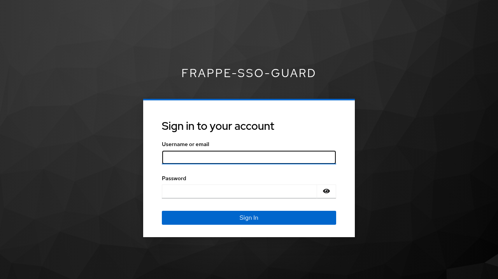

The sign-in page from the Keycloak test realm. Your organisation controls its branding and sign-in prompts.

#### What happens on first sign-in?

The administrator chooses who can join. For an existing Frappe account, the first link needs a matching email that the provider verifies. If new accounts are allowed, the guard can create a Website User at first sign-in. Subsequent sign-ins use the provider’s stable identifier. If your email changes or you reach the website when you expected Desk, ask a System Manager to check your account and roles.

**Who configures what?** The identity administrator registers clients and issues claims. The site operator sets trusted values in `sites/<site>/site_config.json`. A Frappe System Manager manages users, mappings, and settings in Desk. Use Desk search to open the forms named in this manual.

### Connect the identity provider

From a bench that contains the app, run `bench --site <site> install-app frappe_sso_guard`. The steps below configure browser sign-in with Keycloak, Microsoft Entra ID or Generic OIDC.

#### 1. Register the browser client

At the identity provider, enable the authorization-code flow and PKCE S256. Assign the intended people or groups to the client. Register the full Frappe URLs below, substituting your public site address.

```
Sign-in callback  https://frappe.example.org/api/method/frappe_sso_guard.api.callback.handle_callback
After logout      https://frappe.example.org/login
```

1. In the Keycloak admin console, select the realm that owns your users. Go to **Clients → Create client**, choose **OpenID Connect**, and enter a browser client ID (for example `frappe-browser`).
2. Under **Capability config**, enable **Client authentication** and **Standard flow**. Under **Login settings**, add the exact sign-in callback above to **Valid redirect URIs** and the after-logout URL to **Valid post logout redirect URIs**. Save.
3. Set the client's PKCE code challenge method to **S256**. Open **Credentials** to obtain the browser client secret for the Frappe Social Login Key. Use `openid email profile` for the browser sign-in scope.

#### 2. Pin the issuer on the site

Set `sso_issuer` to the exact issuer in the provider’s discovery document. For Keycloak use the realm URL, such as `https://identity.example.org/realms/operations`. For Entra use the tenant-specific v2.0 issuer. The guard discovers endpoints and signing keys from this address.

#### 3. Configure the two Desk forms

Open **Social Login Key**, create a **Custom** provider, select **Enable Social Login**, and enter its provider name, base URL, client ID and secret. Complete these fields and save.

| Social Login Key field | Value |
| --- | --- |
| Authorize URL | `/api/method/frappe_sso_guard.api.callback.start` |
| Redirect URL | `/api/method/frappe_sso_guard.api.callback.handle_callback` |
| Access Token URL | The provider’s token endpoint from discovery. |
| Auth URL Data | `{"response_type":"code","scope":"openid email profile"}` |
| Sign ups | **Deny** admits existing accounts. **Allow** permits first-login creation. An empty choice follows Website Settings. |

In **SSO Identity Settings**, select the saved **Social Login Key** and **Identity Provider Type**. Save. The optional site key `sso_provider_key` supplies the record name when the Desk selection is empty.

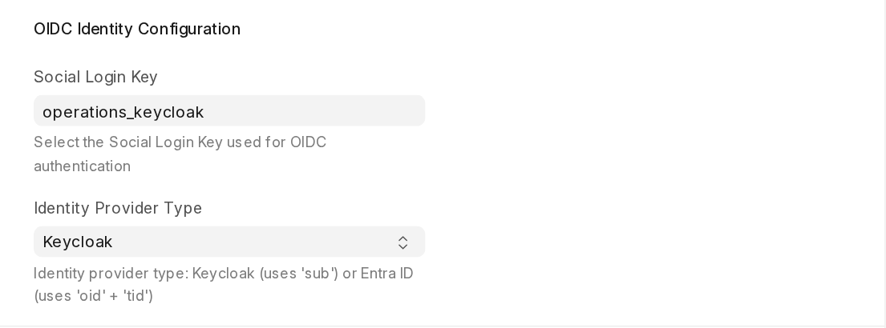

SSO Identity Settings links the site to its browser client.

**Identity claims.** Keycloak and Generic OIDC use `sub` and check `email_verified` when linking an existing account. Entra uses `oid` with `tid`. Configure its optional `email` and `xms_edov` ID-token claims for existing-user binding. The guard checks the token signature, issuer, audience, expiry and browser sign-in state automatically.

### Set sign-in policy and recovery access

#### Choose how Frappe accepts sign-ins

**SSO-only site.** Set `force_sso` to `1` (the default) and run `bench --site <site> migrate`. Migration turns off email-link login, disables public signup, and expires pending invitations. The guard also blocks new invitations and ordinary password resets, and suppresses welcome emails.

**Mixed-access site.** Set `force_sso` to `0` when some users need local sign-in. Provider-bound users and administrative users still require SSO, except the named emergency account. Re-enable email-link login or signup explicitly if your site needs them.

#### Set session duration, logout and MFA

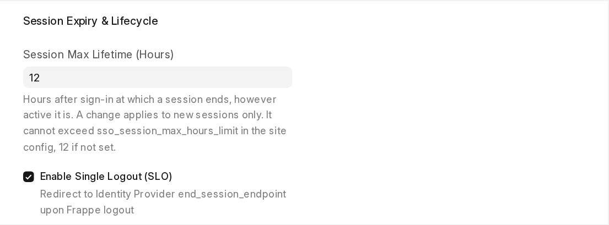

In SSO Identity Settings, the lifetime applies to newly opened SSO sessions.

- **Session Max Lifetime (Hours)** accepts a whole number from 1 through the site ceiling, `sso_session_max_hours_limit` (default 12). The idle timeout is **System Settings → Session Expiry**. The earlier limit ends the session.
- **Enable Single Logout (SLO)** sends the browser through the provider’s logout endpoint when it next reaches `/login` after logout. Register the post-logout URL with the provider.
- **MFA** is enforced at the provider. To also check evidence in the ID token, set `sso_mfa_claim` (default `acr`) and `sso_mfa_values`, for example `["2"]` if your policy issues that value. Verify both fresh and reused provider sessions before setting the accepted values. Omitting them leaves this extra check off.

#### Arrange emergency access

The site operator sets `sso_break_glass_user` to one existing Frappe user and sets its password on the server with `bench --site <site> set-password <user>` (use `set-admin-password` for Administrator). Keep **Disable Username/Password Login** unchecked in System Settings. That user can open `/login?break-glass=1`. For emergency access from the site host, an operator can use:

```
bench --site <site> browse --user Administrator --user-for-audit <operator>
```

Set **Admin Notification Emails** to receive notices for both recovery paths. Test recovery before enforcing SSO. Site configuration changes can take about a minute to reach running workers.

### Manage teams and review accounts

#### Choose the local test site

These addresses belong to the local demos. Each Frappe site has its own users and settings. Sign in to the matching Keycloak realm and Frappe site for each exercise.

| Exercise | Keycloak admin console and realm | Frappe site |
| --- | --- | --- |
| Browser sign-in and UCM teams | [Keycloak on 18080](http://localhost:18080/admin/master/console/)<br>`frappe-sso-guard` | [UCM Administrator login](http://dev.localhost:18000/login?break-glass=1)<br>[User sign-in via Keycloak](http://dev.localhost:18000/login) |
| Server-to-server API access | [Keycloak on 18736](http://localhost:18736/admin/master/console/)<br>`frappe-sso-feature` | [Feature-site Administrator login](http://localhost:18735/login?break-glass=1)<br>[SSO Service Account list](http://localhost:18735/desk/sso-service-account) |

Use your Keycloak admin account in the admin console and select the named realm. The Frappe Administrator login takes the password for that specific Frappe site. Open a private window to test the ordinary user sign-in separately.

#### Assign UCM teams at browser sign-in

1. In the UCM site's Keycloak realm, open **Groups → Create group** and name the group `ucm`. In its actions menu choose **Create child group** and name it `caseworkers`. Reuse the groups if they already exist.
2. Under **Users**, open the test user `sso.active`. For a new test user, choose **Create new user**, enter the username, name and email, then save and set a password in **Credentials**. When linking an existing Frappe account, use its verified email.
3. In the user's **Groups** tab, click **Join Group**, expand `ucm`, select `caseworkers`, and click **Join**.

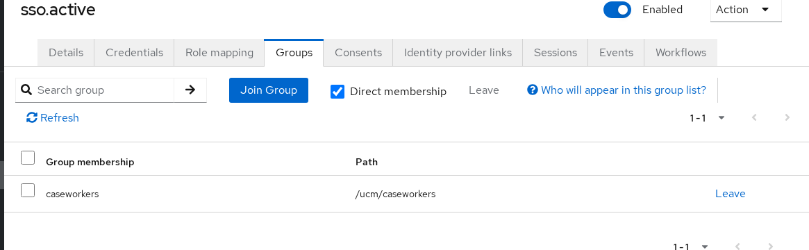

Check the Path column on the user’s Groups tab before testing the browser sign-in.

4. Open **Clients** and select the browser client used by this site's Social Login Key. Under **Client scopes**, open its dedicated scope, then **Mappers**. Open the existing groups mapper, or click **Configure a new mapper** (on a populated list, **Add mapper → By configuration**). In the chooser select **Group Membership**.
5. Set **Name** and **Token Claim Name** to `groups`. Switch on **Full group path** and **Add to ID token**, then save. Under the browser client's **Client scopes → Evaluate**, select the test user and open **Generated ID token**. Look for `"groups": ["/ucm/caseworkers"]`.

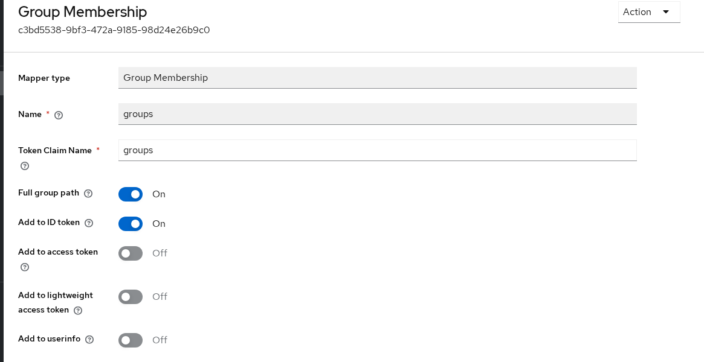

The browser client sends the full group path in the ID token. With Entra, emit the assigned groups’ object IDs.

6. Sign in to the UCM-enabled Frappe site as an administrator. In **SSO Identity Settings**, enable **Set Teams From Identity Provider Groups**, enter `groups` in **Groups Claim**, and save.
7. Open the UCM **Team**, set **Identity Provider Group** to `/ucm/caseworkers` and add the intended **Role Profiles**. The local example uses **SSO Test Team** and the **SSO Test Job** profile, which grants **UCM User**. Save, sign in again as the test user, then check the team's members.

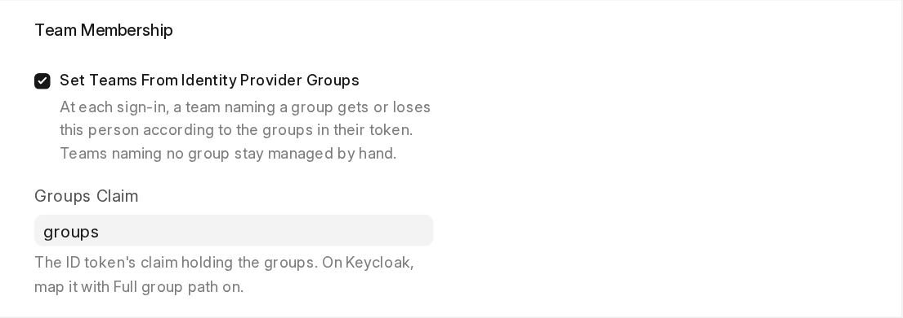

Teams with a group mapping follow the token at sign-in. Other teams keep their manually assigned members.

A missing groups claim counts as empty and can remove access to all mapped teams. Entra group-overage tokens are refused. This feature requires UCM or another installed app that implements the team-membership hook.

#### Disable accounts that have left the directory

1. Give the directory reader `view-users` in Keycloak or Microsoft Graph application permission `User.Read.All` for Entra. Store `sso_directory_client_id` and `sso_directory_client_secret` in the site configuration.
2. In **SSO Identity Settings**, select **Enable Reconciliation**, save, and choose **Run Reconciliation** for a manual run. For recurring checks, choose **Every 15 Minutes**, **Hourly**, or **Daily**.
3. Enable the site scheduler with `bench --site <site> enable-scheduler` and ensure background workers are running. Review the result in **SSO Identity Assignment Log**.

The job disables bound Frappe users who were disabled or removed by the provider and ends their sessions. It preserves their records and skips the emergency and standard users. A failed directory read aborts the run before changes. **Stop If More Than (%) Would Be Disabled** defaults to 10%; batches of up to five users can proceed even on a small site. Entra assignment removal alone does not mark an account disabled.

### Give a service access to the Frappe API

Use the Keycloak client-credentials flow when another system calls Frappe without a person signing in. This feature ships on `feat/keycloak-service-accounts`. The site operator must deploy a build containing it and run `bench --site <site> migrate` before enabling it.

#### 1. Create the machine client in Keycloak

1. In the [feature demo admin console](http://localhost:18736/admin/master/console/), select realm `frappe-sso-feature`. Open **Clients → Create client**. Choose **OpenID Connect**, enter `ucm-integration` as the example client ID, and click **Next**.
2. Under **Capability config**, turn on **Client authentication** and select **Service account roles**. For this machine-only client, clear **Standard flow** and **Direct access grants**. Finish the wizard and save.
3. Open the client's **Credentials** tab. The calling application uses the **Client secret** when requesting a token. Keep it with the caller.

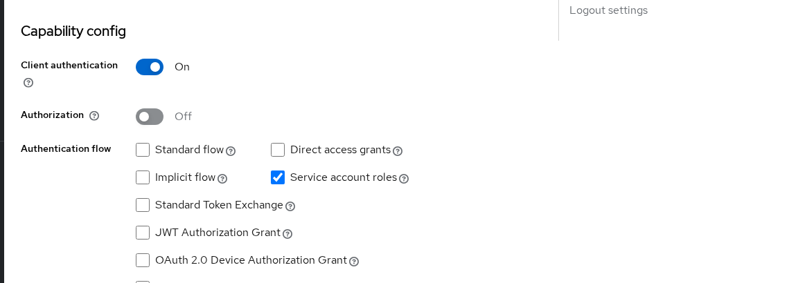

These two settings enable the OAuth client credentials grant for the calling service.

#### 2. Add the Frappe audience and find the service identity

1. Open **Clients → ucm-integration → Client scopes → ucm-integration-dedicated → Mappers**. Click **Configure a new mapper** or **Add mapper → By configuration**. From the table choose **Audience**.
2. Enter `Frappe API` as **Name** and `frappe-api` as **Included Custom Audience**. Enable **Add to access token** and save.

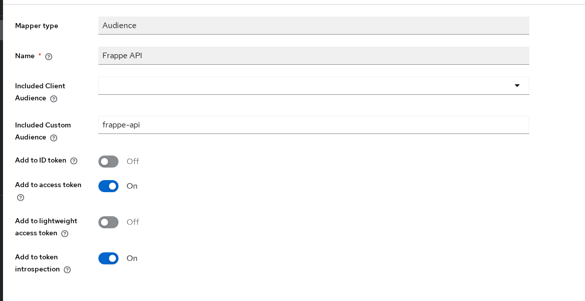

Frappe checks this audience when it receives the access token.

3. Click **Clients** in the left sidebar and reopen **ucm-integration**. In the tabs beneath the client name, click **Service account roles**. If it is missing, return to **Settings → Capability config**, enable the two settings in step 1, and save.
4. Click the username link **service-account-ucm-integration**. On the user's **Details** page, copy the **ID**. This is the service-account subject (`sub`) that Frappe will match.

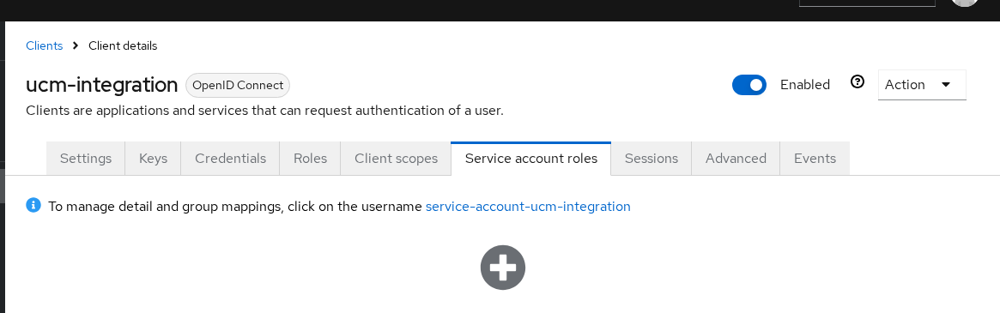

Click the linked username above the role list to open the service-account user.

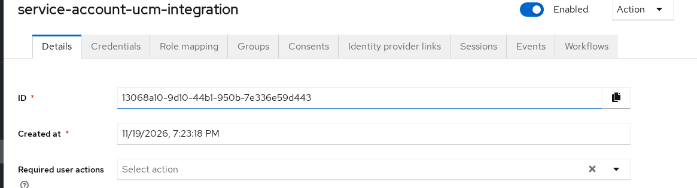

Copy the ID from this user record. The calling client has its own separate identifier.

#### 3. Configure Frappe and save the mapping

In the bench that serves the feature site, set the trusted issuer to the exact Keycloak realm URL and the audience to the value in the mapper. The local demo uses the following values. In a deployment, use the site's own name, the HTTPS issuer supplied by the identity administrator and the agreed API audience.

```
bench --site sso-s2s-feature.localhost set-config sso_issuer http://localhost:18736/realms/frappe-sso-feature
bench --site sso-s2s-feature.localhost set-config sso_service_token_audience frappe-api
bench --site sso-s2s-feature.localhost clear-cache
```

Leaving the service-token audience empty keeps inbound service tokens off. The issuer also controls browser sign-in, so verify its value before changing it on an existing site.

1. Use the [feature-site Administrator login](http://localhost:18735/login?break-glass=1). In [Users](http://localhost:18735/desk/user), create an enabled, dedicated user such as `ucm-integration@example.org`. Assign the business roles the integration needs. Standard, administrative and emergency users are ineligible.
2. As a System Manager, open [SSO Service Account](http://localhost:18735/desk/sso-service-account) and click **Add SSO Service Account** or **New**. If the form is missing, check the site address, the installed app version, the migration and your Desk permissions.

| Frappe field | Example or source |
| --- | --- |
| Keycloak Client ID | `ucm-integration` (the access token’s `azp`) |
| Service Account Subject | The ID copied from the Keycloak service-account user (`sub`) |
| Frappe Integration User | `ucm-integration@example.org` on this site |
| Enabled | Check and save. Frappe fills in **Keycloak Realm Issuer**. |

Frappe matches the signed issuer, client ID and subject. The token’s email is optional.

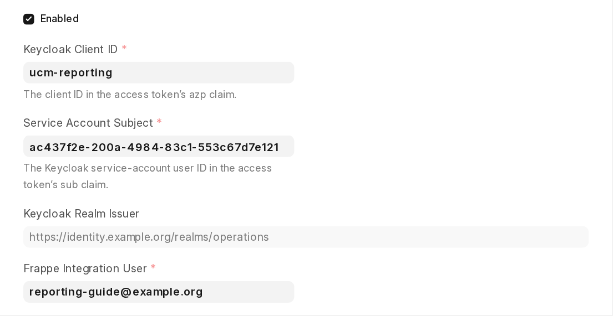

In this example, tokens for `ucm-reporting` map to `reporting-guide@example.org`. The signed subject binds the identity even if its email changes.

#### 4. Verify with two requests in Postman Desktop

Run these requests where the local demo URLs are reachable. Use a fresh request without a Frappe session cookie for the API check.

1. Create a **POST** request to the Keycloak token URL below. Under **Authorization → Basic Auth**, use `ucm-integration` as the username and the Keycloak client secret as the password. Under **Body → x-www-form-urlencoded**, add `grant_type` with value `client_credentials`. Click **Send** and copy the returned `access_token`.

```
http://localhost:18736/realms/frappe-sso-feature/protocol/openid-connect/token
```

2. Create a **GET** request to the Frappe URL below. Under **Authorization → Bearer Token**, paste the access token. Leave the body empty and click **Send**.

```
http://localhost:18735/api/method/frappe.auth.get_logged_user
```

**Expected result** · HTTP 200 and `{"message":"ucm-integration@example.org"}` for the example mapping. Try the intended business API with the same token to verify the user's permissions.

**Test revocation.** Disable the test mapping, save, and repeat the GET with the same unexpired token. Expect HTTP 401. Re-enable the mapping after the exercise. Disabling the mapped Frappe user also revokes access.

If Keycloak rejects the POST, check the realm, client ID, secret and service-account setting. If Frappe rejects the GET with 401, check the issuer, audience, subject, expiry, enabled mapping, user eligibility and IP restrictions. A 403 on a business operation calls for checking the mapped user's roles and permissions.

### Manage API keys, reports and the audit log

#### Issue a native Frappe API key

If the integration uses Frappe’s own key and secret, open the dedicated **User**. With forced SSO, a System Manager must set **Restrict IP** to approved addresses and enable **Allowed To Hold An API Key**. Save, then use **Generate Keys** under **API Access**. Accounts holding Administrator, System Manager, UCM Administrator or UCM Data Manager roles are ineligible. The caller sends `Authorization: token <api_key>:<api_secret>`.

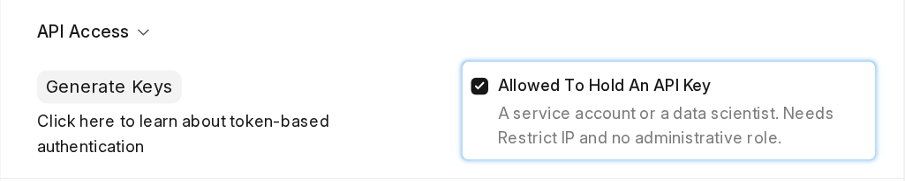

User → API Access. Key issuance produces an **API Key Created** event.

The daily scheduled check flags key holders outside those rules. When the directory reader is configured, it also checks provider-bound key holders and disables users the provider removed or disabled. The daily check runs independently of the reconciliation switch.

#### Review inactivity and notifications

In **SSO Identity Settings → Administration & Notifications**, enter comma-separated **Admin Notification Emails** and configure outgoing email in Frappe. Under **Deprovisioning & Reports**, set **Inactivity Threshold (Months)** (default 6). The monthly job emails recipients when it finds enabled System Users with an old or missing last login. It reports accounts for human review and leaves them enabled.

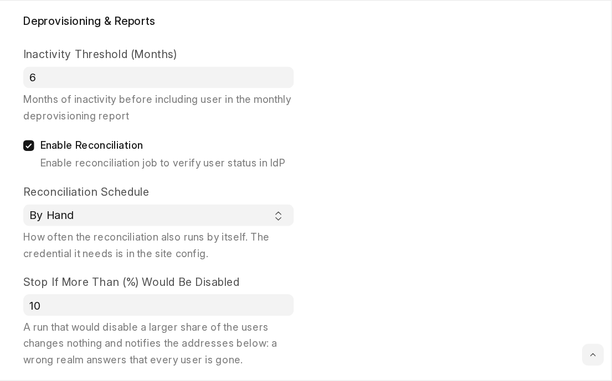

Reconciliation disables confirmed leavers. The monthly inactivity report identifies people whose access may need review.

#### Find the evidence

Open **SSO Identity Assignment Log** in Desk and filter by **Event Type**, user or time. Check **Login Success** or **Session Refused** for sign-in, **Team Added/Removed** for team changes, and **Reconciliation Run/Aborted** for directory checks. Open a row for its status, timestamp and details. Desk entries are append-only. The app also writes structured `sso_audit` events to the application logs; some early unauthenticated refusals appear only there.

## License

MIT
